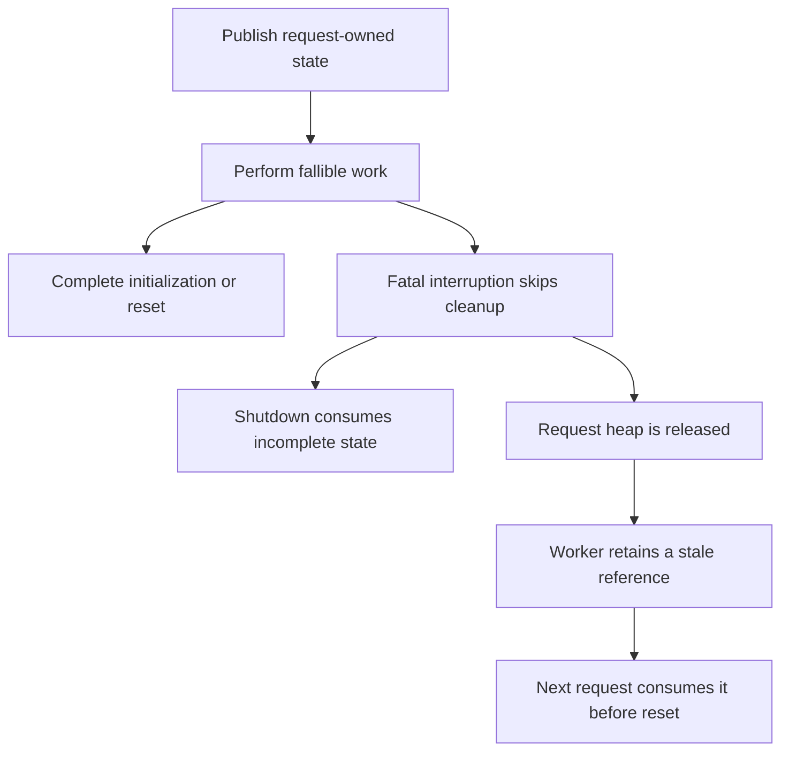

# Análisis de PHP2Shell y del parche de PHP 8.5.12

Fecha de revisión: 21 de octubre de 2026. Alcance: post de Wiz, avisos oficiales, commits del fix, código anterior y corregido, y pruebas de regresión relevantes. Método: revisión estática de fuentes públicas; no se ha ejecutado una cadena de explotación ni se ha auditado un servidor desplegado.

## 1. Resultado

PHP2Shell agrupa fallos de seguridad de memoria del propio intérprete. Una interrupción fatal puede dejar estructuras a medio construir o referencias a memoria de una petición que ya terminó. La limpieza de esa petición, otra petición en el mismo worker o, en OPcache, otro worker pueden consumir ese estado inválido. Las consecuencias incluyen denegación de servicio, exposición de memoria y ejecución de código con los privilegios del proceso web.

El parche aborda tres obligaciones distintas: completar o abandonar las operaciones de memoria de forma segura; reinicializar los datos antes de cualquier consumidor temprano; y publicar coherentemente el estado compartido de OPcache. La reconstrucción de estas obligaciones se desarrolla a partir del código en las secciones 4 y 5.

Los identificadores oficiales son los siguientes:

| Identificador | Categoría oficial | Aviso |
| --- | --- | --- |
| CVE-2026-109618 | Corrupción por manejo de falta de memoria, OOM | [GHSA-w8hw-w9fx-j79w][A1] |
| CVE-2026-109619 | Uso de estado global obsoleto entre peticiones | [GHSA-6wmf-4rv5-p3rp][A2] |

Ambos avisos asignan severidad crítica, CVSS **4.0: 9,2**, con vector `CVSS:4.0/AV:N/AC:H/AT:P/PR:N/UI:N/VC:H/VI:H/VA:H/SC:N/SI:N/SA:N`. La puntuación combina acceso por red sin autenticación con complejidad alta y condiciones adicionales de ataque; no significa explotación idéntica en cualquier instalación. [Avisos oficiales][A1] [de ambas familias][A2].

## 2. Versiones y fechas verificadas

| Rama estable | Versiones de la rama anteriores al fix | Primera versión corregida |
| --- | --- | --- |
| 8.2 | 8.2.0–8.2.34 | 8.2.35 |
| 8.3 | 8.3.0–8.3.35 | 8.3.36 |
| 8.4 | 8.4.0–8.4.26 | 8.4.27 |
| 8.5 | 8.5.0–8.5.11 | 8.5.12 |

La matriz procede del anuncio y los avisos oficiales. Debe aplicarse a versiones upstream: un proveedor puede incorporar el fix mediante backport sin cambiar al mismo número de versión. PHP también anuncia el arreglo en 8.6.0 RC4, una versión de pruebas. [Anuncio de PHP][A3].

Las ramas antiguas no quedan declaradas seguras por estar fuera de esa tabla. Calif sitúa una ruta afectada desde PHP 5.4.0. PHP publicó excepcionalmente backports mínimos de código para [7.4][B74], [8.0][B80] y [8.1][B81]; eso no restablece su soporte ordinario ni equivale a una nueva versión mantenida. Para instalaciones antiguas, comprobar el boletín del proveedor o migrar a una rama soportada. [Investigación de Calif][A5]; [anuncio de PHP][A3].

Hay una discrepancia documental: el [changelog solicitado][A4] fecha 8.5.12 el **22 de octubre**, mientras el anuncio y la [release publicada en GitHub][REL] corresponden al **21 de octubre de 2026**; su API registra publicación a las 14:06:46 UTC. No debe deducirse del changelog que el parche todavía no estaba disponible al realizar esta revisión.

La PHP Foundation explica el cambio: tras circular los identificadores antes del embargo, adelantó la publicación prevista del 22 de octubre a las 14:00 UTC al 21 a la misma hora. Por tanto, hay explicación oficial del adelanto; el changelog conserva la otra fecha. [Relato de la PHP Foundation][FOUNDATION].

## 3. Qué «PRs» contiene realmente el fix

El changelog enlaza avisos de seguridad, no PRs. Se identificó el commit principal y su propagación entre ramas:

| Papel | Commit verificable |
| --- | --- |
| Fix base, PHP 8.2, `Avoid state corruption via bailout` | [`3584a98bda0f2c0d367255b046798b0d3a221a19`][C82] |
| Integración en PHP 8.3 | [`c1a5f468d09fc4afc5d738872d5b1d4e87ff1e39`][C83] |
| Integración en PHP 8.4 | [`8a94bb3822b9913926b64078b2dfec5e8092ba1b`][C84] |
| Integración en PHP 8.5 | [`c7273b9ba89cc8c0beaf19c03a77332361e7a89e`][C85] |

Las consultas de PRs asociadas al [commit base][P82] y al [commit de 8.5][P85] devolvieron listas vacías. Las búsquedas por título y GHSA tampoco identificaron una PR pública del fix. Por tanto, esta es una revisión de los commits públicos; no se atribuyen revisiones, aprobaciones o discusiones de una PR inexistente en la evidencia consultada. Esto no excluye coordinación privada de seguridad.

La respuesta completa y paginada de GitHub para el commit base contiene **389 archivos, 10.759 líneas añadidas y 988 eliminadas**, incluidos **249 PHPT nuevos y 17 modificados**. El diff de integración en 8.5 comprende 424 archivos. Son cambios extensos de infraestructura y pruebas, no cuatro arreglos independientes de unas pocas líneas. Los diffs se revisaron por áreas críticas; no se hizo una auditoría exhaustiva de cada archivo. [Commit base][C82]; [integración 8.5][C85].

## 4. Reconstrucción técnica de la vulnerabilidad

### 4.1. El límite entre petición y proceso

Un worker puede atender muchas peticiones. El heap de una petición se libera al terminar, pero determinadas variables globales del worker y la memoria compartida de OPcache sobreviven. Toda referencia desde esos ámbitos persistentes hacia memoria temporal exige un ciclo de vida bien definido.

En PHP 8.5.11, `php_request_startup()` inicializa el ejecutor y activa la SAPI; más adelante llama a `php_hash_environment()` y después a `zend_activate_modules()`. Esto permite procesar entradas y callbacks antes del `RINIT` ordinario de los módulos. Durante el cierre, `zend_deactivate_modules()` depende de `PG(modules_activated)`, mientras la destrucción del heap se realiza también cuando ese indicador no llegó a activarse. [Inicio y cierre anteriores al fix][OLDMAIN].

El patrón peligroso puede expresarse así:



El primer desenlace permite corrupción dentro de la misma petición. El segundo requiere que el proceso conserve el estado y vuelva a consumirlo. La distinción explica por qué eliminar la reutilización de workers solo afecta a ciertas rutas.

**La familia de estado obsoleto no exige OOM:** también pueden intervenir errores fatales de compilación, excepciones no capturadas, fallos de `require`, timeouts o diagnósticos tardíos que repueblen estado ya limpiado. Siempre se necesita un productor y un consumidor alcanzables. [Aviso de estado obsoleto][A2].

### 4.2. Estructura parcialmente inicializada: HashTable

La implementación anterior de `_zend_hash_str_add_or_update_i()` incrementa los contadores de una tabla antes de reservar e inicializar completamente la nueva entrada. El orden relevante es:

```c
idx = ht->nNumUsed++;
ht->nNumOfElements++;
p = ht->arData + idx;
p->key = key = zend_string_init(str, len, GC_FLAGS(ht) & IS_ARRAY_PERSISTENT);
/* Remaining bucket initialization follows. */
```

La asignación de la clave puede agotar memoria. Si la salida no local interrumpe ahí la función, los contadores ya anuncian una entrada válida, pero no se han establecido todos sus campos. Una rutina de destrucción que recorra las entradas publicadas puede interpretar bytes anteriores como un `zval` o un puntero. El problema es el incumplimiento del invariante «toda entrada contabilizada es destruible». [Código vulnerable de HashTable][OLDHASH].

La entrada a estas operaciones no tiene por qué proceder de código PHP explícito: registrar las variables de formularios y los metadatos de uploads también construye tablas. El fix incorpora asignaciones que permiten propagar el fallo y restaura el tamaño original si una conversión de tabla empaquetada a tabla hash no termina correctamente. Esto confirma que proteger solo los punteros de sesión no cubriría toda la familia. [HashTable corregida][NEWHASH].

### 4.3. Sesiones y progreso de uploads antes de RINIT

El mecanismo de progreso de uploads utiliza estado de sesión durante el parsing del cuerpo. El manual documenta que ese trabajo precede a la ejecución del script: modificar sus opciones desde la aplicación llega tarde para la petición que ya está entrando. [Manual de upload progress][MSESSION].

`session.upload_progress.enabled` está activado por defecto. El callback puede iniciar ese trabajo sin que el script llame a `session_start()` y sin necesitar un warning de configuración: constituye una vía temprana propia. [Valores predeterminados][MSESSIONCONFIG]; [callback de Session][OLDSESSION].

En el código anterior, el callback de inicio de archivo puede ejecutar `php_rinit_session(0)` y publicar `PS(id)`; el cierre del multipart llama a la limpieza correspondiente. Una interrupción entre ambos puntos puede omitir esa limpieza. Si tampoco se activaron los módulos, no se ejecuta su cierre ordinario, pero sí se libera el heap. Quedan referencias del módulo Session a memoria liberada. [Session anterior][OLDSESSION]; [cierre de petición anterior][OLDMAIN].

Existe además una diferencia entre inicializar el estado al comienzo de todo multipart e inicializarlo únicamente al entrar en ciertos eventos de archivo: los recorridos de cierre no tienen por qué haber pasado por esos eventos. El parche mueve una reinicialización de Session a `MULTIPART_EVENT_START`. Así, el siguiente procesamiento multipart parte de valores conocidos antes de poder consumirlos. [Session corregida][NEWSESSION].

Wiz documenta una manifestación de lectura de memoria: un `PS(id)` obsoleto se interpreta como `zend_string` y sus contenidos llegan a una cookie de sesión de respuesta. La divulgación puede existir sin completar RCE. El post también documenta una cadena basada en el estado del deserializador y demostraciones en WordPress, Drupal y Joomla. Son resultados publicados por los investigadores, no reproducciones realizadas aquí. [Post de Wiz][A6].

### 4.4. Estado del deserializador: `BG(unserialize)`

`php_var_unserialize_init()` guarda en `BG(unserialize).data` estructuras de referencias y destrucción; `level` indica su anidamiento. Cuando ya hay una operación activa, otra llamada reutiliza ese estado. `php_var_unserialize_destroy()` debe cerrar el nivel y retirar el puntero global cuando corresponde. [Deserializador anterior][OLDUNSER].

Si un error fatal evita el cierre y después se libera el heap, el siguiente consumidor puede confundir el puntero obsoleto con el contexto de una deserialización anidada todavía activa. Esta condición no equivale a la conocida inyección de objetos PHP: el fallo reside en el tiempo de vida del bookkeeping nativo, con independencia de que los datos originales fueran legítimos.

El nuevo `php_basic_early_rinit()` pone a cero el estado de serialización y deserialización, además del bloqueo y del estado temprano del reescritor de URLs. Se llama después de `zend_activate()` y antes de `sapi_activate()`, anticipándose al procesamiento de entradas. El sitio de la llamada es tan importante como el reset: hacerlo únicamente en el `RINIT` habitual dejaría abierta la ventana. [Basic corregido][NEWBASIC]; [inicio corregido][NEWMAIN].

### 4.5. Backtrace fatal y otros estados del ejecutor

PHP 8.5 incorpora `fatal_error_backtraces`, habilitado por defecto. El backtrace se conserva en `EG(last_fatal_error_backtrace)`, mientras su contenido pertenece al contexto de una petición. [Configuración documentada][MERROR].

En el manejo de errores se consulta o destruye el backtrace anterior. Si ese valor sobrevivió a la liberación de su memoria, un diagnóstico de una petición posterior puede alcanzarlo antes de que el ejecutor lo reinicialice. El código corregido añade una invalidación explícita al terminar la limpieza del ejecutor; también reinicia el registro de errores, el modo de manejo y el puntero de excepción. [Manejo de errores corregido][NEWZEND]; [cierre del ejecutor corregido][NEWEXEC].

La defensa requiere invalidar el estado también cuando no se ha recorrido la ruta de limpieza ideal. En `main/main.c`, el fix vuelve a limpiar el último error antes de destruir el administrador de memoria y deja las superglobales liberadas como `UNDEF`. Es una reparación del contrato de vida útil, no una modificación cosmética de los mensajes de error. [Cierre corregido][NEWMAIN].

### 4.6. OPcache: publicación compartida incompleta

OPcache introduce un ámbito distinto: los metadatos compartidos pueden referirse a índices de mapas de punteros cuyo contenido efectivo es local a cada worker. El contador local `CG(map_ptr_last)` y el compartido `ZCSG(map_ptr_last)` deben concordar con los índices que ya se han publicado.

El código del fix documenta que publicar un slot de caché de clase y salir antes de actualizar el límite compartido permite que otro proceso reutilice ese índice para otro propósito. El lector puede entonces tratar como referencia a una clase un puntero de otra clase de objeto: confusión de tipos entre workers. [Invariante documentado en OPcache][NEWPERSIST].

La solución introduce `zend_accel_pending_ce_cache_begin()`, `commit()` y `discard()`. Los slots pendientes se guardan localmente; solo se publican después de actualizar la frontera compartida. Las ventanas abandonadas se descartan. El recorrido de carga desde file cache también descarta pendientes y restaura el contador si la operación falla. [Publicación corregida][NEWPERSIST]; [file cache corregida][NEWFILECACHE].

Por tanto, terminar un worker no demuestra por sí solo que todo el estado compartido sea coherente. Tampoco desactivar OPcache neutraliza las rutas de sesión o de tablas del núcleo.

### 4.7. Por qué los límites habituales no bastaban

El parche de `main/rfc1867.c` permite identificar dos problemas de superficie de entrada: comprobar solo el tamaño declarado no controla necesariamente los bytes leídos; y almacenar cabeceras multipart que el parser no necesita introduce amplificación de memoria. El fix comprueba bytes consumidos, conserva únicamente las cabeceras utilizadas y evita almacenar duplicados. [Diff del parser][C82]; [parser corregido][NEWRFC].

Calif describe además amplificación mediante metadatos de uploads vacíos y nombres anidados: el tamaño de las estructuras internas puede superar ampliamente el del cuerpo HTTP. También documenta la ruta FPM que interrumpe una deserialización después de un arranque satisfactorio y reutiliza el estado en una petición posterior. La presión de memoria y el orden del ciclo de vida son condiciones técnicas; el tamaño de un archivo subido no resume toda la exposición. [Investigación de Calif][A5].

## 5. Revisión del diseño del parche

### 5.1. OOM diferido y dos límites

El nuevo administrador de memoria diferencia entre el límite ordinario y un límite duro:

| Situación | Comportamiento observado en el código |
| --- | --- |
| Se rebasa el límite ordinario | Se registra un OOM pendiente y se solicita una interrupción de VM. |
| La operación usa una asignación que admite fallo | Puede devolver `NULL` o `FAILURE` y conservar una estructura válida para su limpieza. |
| La operación exige completar la asignación | Puede utilizar el margen hasta el límite duro para restablecer sus invariantes. |
| Se alcanza un punto seguro | `zend_handle_delayed_oom()` procesa el error y termina la ejecución de la petición. |
| La asignación no recuperable superaría el límite duro | Se termina el proceso mediante `_exit(137)`. |

El comportamiento predeterminado del límite duro es el doble del límite ordinario hasta 1 GiB; para límites superiores añade 1 GiB, con protección frente a desbordamientos. Se añade `memory_hard_limit_percent` para configurarlo. Este margen es relevante para dimensionar pools y contenedores. [Administrador de memoria corregido][NEWALLOC]; [registro de configuración][NEWMAIN].

Una precisión de revisión: el parche no elimina todos los `zend_bailout()` del intérprete. El manejador diferido todavía puede usarlos al abortar sin un frame ejecutable. La mejora es evitar el salto arbitrario desde una asignación que deja invariantes rotos, y realizar el aborto desde un contexto adecuado. Tampoco debe interpretarse el margen como permiso para continuar normalmente tras un OOM. [Implementación del manejador diferido][NEWALLOC].

El momento observable del fallo cambia: una prueba espera salida del script, después el error fatal y después su callback de shutdown. Cruzar el límite ordinario no implica un aborto instantáneo en esa misma instrucción. Si falla realmente una reserva del sistema, `zend_out_of_memory()` sigue un camino distinto y termina con `exit(1)`. [Prueba del error diferido][TAFTER]; [asignador corregido][NEWALLOC].

### 5.2. Barreras adicionales y compatibilidad

| Área | Cambio y efecto |
| --- | --- |
| Inicialización temprana | Basic y Session reinician estado antes de sus consumidores de entrada. |
| Cierre | Se invalidan backtraces, errores, excepciones y superglobales que podrían alcanzarse fuera del ciclo normal. |
| Upload progress | La deserialización temprana conserva objetos como clases incompletas y evita autoload, `__wakeup()`, `__unserialize()` y callbacks de usuario en esa fase. |
| Sesión | Se comprueba si la inicialización realmente tuvo éxito; ya no se fuerza el estado activo después de un fallo. |
| `request_parse_body()` | El callback evita ejecutar el seguimiento de uploads sobre una sesión ya activa en la fase de aplicación. |
| Multipart | Se detiene trabajo cuando hay OOM pendiente, se limpian temporales y se propagan fallos de registro de variables. |
| OPcache | Publicación diferida de slots y descarte de operaciones incompletas. |
| VM y JIT de 8.5 | Puntos de interrupción compatibles con llamadas frameless y código compilado. |

Evidencia: [Session][NEWSESSION], [Basic][NEWBASIC], [main][NEWMAIN], [parser][NEWRFC], [OPcache][NEWPERSIST] y [diff de 8.5][C85].

Son cambios observables: una extensión que esperaba callbacks de objetos durante upload progress deja de obtenerlos; una petición puede alcanzar temporalmente más memoria que el antiguo límite; un límite duro termina el proceso sin la limpieza PHP habitual. Conviene validar sesiones, cargas multipart, extensiones nativas, handlers de salida y políticas de reinicio con la versión corregida. Son consecuencias del diseño observado, no regresiones demostradas por esta revisión.

Existe además una incompatibilidad deliberada: se rechazan registros de sesión cuyos objetos contienen propiedades públicas exactas `__PHP_Incomplete_Class_Name`, `__PHP_Incomplete_Class_Serialized` o `__PHP_Incomplete_Enum_Case`. La prueba espera la destrucción del registro para impedir confusión con la representación interna. [Prueba de propiedades reservadas][TRESERVED].

Mi valoración del fix es favorable respecto a las causas identificadas: añade garantías sobre asignaciones, inicialización y publicación compartida. Aplicar solo una de esas piezas no reproduce el conjunto de garantías del release. La extensión del diff y la cobertura de pruebas tampoco prueban la ausencia de cualquier otra vulnerabilidad del motor.

## 6. Condiciones reales de explotación

La decisión de la SAPI tras un fallo de inicio es decisiva. En mod_php, el handler puede llegar al destructor de petición después del bailout; ese destructor llama a `php_request_shutdown()`. En FPM, un `php_request_startup()` fallido finaliza el child. Pero después de un inicio satisfactorio, el bucle FPM realiza el cierre normal y puede atender otra petición. [SAPI Apache anterior][OLDAPACHE]; [bucle FPM anterior][OLDFPM].

| Entorno o condición | Evaluación |
| --- | --- |
| Apache + mod_php | Mayor exposición demostrada: existen rutas anteriores al código de aplicación. |
| FPM, fallo durante startup | El child termina; no sobrevive para consumir su estado en la siguiente petición. |
| FPM, fallo después de startup | Puede sobrevivir; hay RCE validada para el ciclo de sesión, dependiente de una operación adecuada de la aplicación. |
| FrankenPHP / LSAPI | Los avisos describen susceptibilidad por análisis de código y condiciones; no equiparar esto a todas las demostraciones de mod_php. |
| Proceso de una sola petición | Reduce las rutas entre peticiones; no demuestra protección frente a corrupción durante la limpieza ni frente a estado compartido. |

El aviso OOM no declara un exploit completo FPM demostrado para **109618**. La demostración FPM mediante estado del deserializador corresponde al ciclo de sesión descrito en la sección 4.4. [Aviso OOM][A1]; [demostración y explicación de Calif][A5].

La ruta de backtrace exige un consumidor temprano. En FPM, `PHP_VALUE`/`PHP_ADMIN_VALUE` del frontend pueden producirlo; los valores del pool se aplican al crear el worker y `.user.ini` después de inicializar la petición. Un warning cualquiera no demuestra explotabilidad. [Condiciones oficiales][A2].

Para evaluar una instalación hacen falta la versión o backport real, SAPI, extensiones, configuración efectiva, frontend, rutas de entrada y supervivencia de workers.

En entornos **Apache prefork + `mod_php`**, una conexión HTTP/1.1 persistente (**Keep-Alive**) garantiza de forma determinista que las peticiones secuenciales se ejecuten en el **mismo proceso worker (mismo PID y mismo espacio de direcciones virtuales)**. Asimismo, ante un error fatal de memoria (`Fatal error: Allowed memory size exhausted`), `zend_bailout()` interrumpe la petición pero Apache **no finaliza el proceso hijo**, permitiendo que el worker sobreviva y retenga referencias obsoletas (`PS(id)`, `BG(unserialize)`) en la memoria global de cara a peticiones posteriores. La autenticación implementada dentro del script tampoco protege el código del intérprete ejecutado antes de él. Estas son deducciones y validaciones del ciclo de ejecución revisado.

## 7. Lectura crítica del post de Wiz y mecánica de RCE

El post aporta demostraciones y cuatro manifestaciones: deserializador de progreso de uploads, divulgación mediante sesión, backtrace fatal y confusión de tipos en OPcache. Su tabla agrupa los bugs por CVE de forma que no coincide exactamente con la organización conceptual de los avisos finales. Para inventario y remediación se deben conservar los nombres y requisitos oficiales; las manifestaciones pueden compartir mecanismos. [Wiz][A6]; [avisos oficiales][A1] [A2].

### 7.1. Mecánica de la cadena de RCE sin gadgets ROP (`PG(auto_prepend_file)`)

La demostración técnica publicada por Wiz (ver [demostración en vídeo][WIZ_VIDEO]) desvela cómo transformaron una corrupción de memoria en **ejecución remota de comandos independiente de la distribución o versión de `libc`**, prescindiendo de cadenas ROP o shellcode binario (`GADGETS: none; runtime-resolved PHP global-pointer override`):

1. **Disparo OOM y Fuga de Memoria Cruda (ASLR Bypass):**
   - Una petición `multipart/form-data` con múltiples entradas vacías (`filename=""`) satura `rfc1867.c` antes de `RINIT`.
   - `zend_bailout()` deja el puntero de sesión `PS(id)` apuntando a memoria liberada del asignador (`ZendMM`).
   - La respuesta HTTP devuelve una ventana viva de 256 bytes de memoria en la cabecera `Set-Cookie: PHPSESSID=...` (*Raw Disclosure*).
   - De esa fuga, el exploit extrae punteros de 64 bits hacia la sección de código y datos de `libphp.so` (`text` y `rodata`) y el *main chunk* del heap.
2. **Resolución Dinámica de Símbolos en Memoria:**
   - En lugar de depender de offsets fijos del sistema operativo o de `libc`, el exploit resuelve en caliente la cabecera ELF de `libphp.so` presente en la memoria del proceso para ubicar la estructura `php_core_globals`.
   - Localiza la posición exacta del puntero `char *auto_prepend_file` (`PG(auto_prepend)`).
3. **Acondicionamiento del Heap (*Heap Grooming*) vía Keep-Alive:**
   - A través de la misma conexión TCP persistente, se envían peticiones calculadas para que el *Zend Memory Manager* asigne los datos del atacante en el slot de memoria liberado.
   - Se sobrescribe `PG(auto_prepend_file)` para que apunte a un stream o payload en memoria con código PHP (e.g. `<?php system('/usr/bin/id');?>`).
4. **Ejecución Nativa en el Intérprete:**
   - En la siguiente petición al mismo worker, el motor PHP consulta legítimamente su directiva global `PG(auto_prepend_file)`, compila el payload en memoria y ejecuta el comando con los privilegios de `www-data` en ~65 segundos.

Esta técnica confiere al exploit una naturaleza **universal**: no se rompe por cambios menores en librerías del sistema operativo, pues aprovecha el propio compilador e intérprete de PHP como ejecutor.

### 7.2. Evaluación del alcance comunicado

El texto de la PHP Foundation también menciona RCE en FPM junto al apartado OOM. Ante esa diferencia de presentación, este informe utiliza los requisitos y la clasificación de los GHSA para separar las familias; no convierte una demostración FPM en prueba de todas las rutas OOM. [Publicación de la Foundation][FOUNDATION].

La afirmación del titular sobre el 70 % refleja la presencia de PHP en la web, no una medición de instalaciones explotables con una misma petición. Las demostraciones publicadas prueban impacto en sus objetivos; no sustituyen la matriz de SAPI y configuración. Tampoco el uso de IA aporta por sí mismo evidencia sobre una configuración concreta.

Wiz fecha su descubrimiento el 19 de agosto, el reporte a PHP el 24 de agosto y la divulgación el 21 de octubre. Calif informa de una investigación paralela, un primer reporte el 11 de agosto y validación de su PoC por PHP el 15. Son cronologías distintas, no una razón para adjudicar a todo el trabajo la fecha del reporte de Wiz. [Wiz][A6]; [Calif][A5].

No se ha verificado en esta revisión explotación activa de PHP2Shell en Internet. La Foundation indica que no había identificado exploits públicos funcionales en el momento de publicación; esa observación está limitada a ese momento. Deben mantenerse separadas la publicación de detalles técnicos, la existencia de demostraciones y la observación de ataques reales. [Estado comunicado al divulgarse][FOUNDATION].

## 8. Remediación y detección

### 8.1. Actuación principal

Actualizar el runtime a una versión corregida o a un paquete con backport acreditado; reconstruir las imágenes correspondientes y reemplazar los procesos antiguos. Actualizar únicamente el CMS no modifica el código vulnerable del intérprete. Comprobar la versión que realmente atiende peticiones, no solo el CLI o la etiqueta de una imagen. [Anuncio de PHP][A3].

Criterio operativo propuesto: inventario de todos los pools y servicios, evidencia del paquete corregido, ausencia de workers con binarios anteriores y comprobación funcional de sesiones y uploads. Si se sospecha intrusión, conservar evidencia y revisar credenciales expuestas: instalar el parche no revoca secretos ni retira persistencia que un atacante hubiera creado.

### 8.2. Medidas temporales, con alcance limitado

Para OOM, PHP recomienda `memory_limit=-1` impuesto administrativamente y reiniciar workers; elimina el disparador predecible del límite PHP, pero un fallo real del asignador sigue siendo peligroso. Evitar `RLIMIT_AS` y `RLIMIT_DATA`, que pueden provocar precisamente ese fallo. Aplicar límites externos de recursos y del cuerpo decodificado, contemplando peticiones sin longitud útil. Esta configuración cambia el riesgo de disponibilidad y no sustituye actualizar. [Aviso OOM][A1].

Para las rutas de sesión, desactivar `session.upload_progress.enabled = Off` antes del parsing y reiniciar los workers; `ini_set()` llega tarde. En pruebas dinámicas se constata que desactivar esta directiva impide que `rfc1867.c` ejecute `php_rinit_session` y asigne `PS(id)` en la fase `Unknown on line 0`, neutralizando de raíz la fuga de memoria en `Set-Cookie` y la ventana de sobreescritura de punteros globales empleada por la cadena de RCE. En PHP 8.5, desactivar `fatal_error_backtraces` corta esa manifestación. Eliminar diagnósticos tempranos y corregir fatales o timeouts alcanzables reduce exposición; ocultar errores no evita el acceso al estado. Son medidas parciales pero de alta eficacia inmediata mientras se aplica el parche. [Aviso de estado obsoleto][A2]; [manual de sesiones][MSESSION].

Un WAF puede reducir superficie mientras se instala el fix. Cloudflare anunció reglas tanto de petición como de respuesta y mantiene la recomendación de parchear. Su cobertura depende del tráfico que atraviese la protección; este informe no validó reglas contra ninguna instalación. [Información de Cloudflare][WAF].

### 8.3. Investigación de posibles intentos

Como hipótesis defensivas derivadas del mecanismo, correlacionar por tiempo, ruta y PID del worker:

- Multipart anómalos seguidos de errores de memoria o de una concentración de respuestas 5xx.
- Valores de cookies de sesión de respuesta con tamaño o contenido incompatibles con el formato esperado.
- Reinicios, crashes o comportamiento de procesos hijos inesperados en el usuario del servidor web.
- Cambios de archivos o conexiones salientes posteriores a esos eventos.

Estas señales son inespecíficas: un fallo de aplicación también puede causarlas. Su ausencia no descarta una fuga ni una ruta previa al logging de la aplicación. Evitar registrar indiscriminadamente cookies completas o memoria: la propia recogida podría almacenar secretos. No se propone una firma universal ni se certifica detección completa.

## 9. Pruebas y límites de la verificación

Se comprobaron los avisos, la disponibilidad de las releases, los commits y la ausencia de PRs públicas asociadas a los dos commits consultados. Se contrastaron archivos relevantes de `php-8.5.11` y `php-8.5.12`, y el diff paginado del fix base.

Cinco comprobaciones estáticas adicionales confirmaron en la fuente corregida: llamada temprana a Basic, reset de Session en el inicio del multipart, presencia del manejador OOM diferido, publicación de slots de OPcache posterior al contador compartido e invalidación del backtrace antes de reutilizar el ejecutor. Estas comprobaciones validan afirmaciones del informe, no el comportamiento de un binario compilado.

Entre las pruebas revisadas hay cobertura de recuperación entre peticiones: `sapi/cli/tests/oom_request_parsing_next_request.phpt` y `oom_shutdown_function_next_request.phpt` comprueban una petición posterior después de OOM, incluyendo funcionamiento de autoload. Son pruebas del servidor CLI, no una reproducción de RCE en un pool FPM. [Prueba de parsing][TREQUEST]; [prueba de shutdown][TSHUTDOWN].

Otras pruebas concretas permiten evaluar qué garantiza el parche:

| Prueba | Comportamiento esperado |
| --- | --- |
| [`oom_after_main_script.phpt`][TAFTER] | Salida previa al error diferido y ejecución posterior del shutdown. |
| [`oom_hard_limit_exceeded.phpt`][THARD] | Límite ordinario de 10 MiB, duro de 20 MiB y terminación sin callback de shutdown. |
| [`rfc1867_no_user_code.phpt`][TUSERCODE] | Conservación de datos y referencias de objetos durante upload progress, sin ejecutar sus callbacks hasta el arranque explícito de sesión. |
| [`rfc1867_incomplete_class_reserved_props.phpt`][TRESERVED] | Rechazo de propiedades que colisionan con el estado interno. |
| [`incomplete_class_raw_payload_markers.phpt`][TMARKERS] | Propiedades de usuario no deben alterar indebidamente el tipo de representación serializada. |
| [`frameless_interrupt_001.phpt`][TJIT1], [`002`][TJIT2] y [`003`][TJIT3] | Interrupción sin repetir llamadas frameless y conservación del estado al abandonar una traza JIT. |

El parche añade también `ZEND_MM_MAX_ALLOCS` para ejercitar fallos en posiciones concretas de la secuencia de asignaciones. Esta cobertura es pertinente para detectar estados intermedios que no se prueban simplemente enviando una entrada grande. No demuestra exhaustivamente todas las cadenas remotas ni la seguridad de extensiones ajenas al árbol PHP. [Infraestructura del fix][C82].

**No ejecutado:** compilación de PHP corregido, suite PHPT, sanitizadores ni pruebas HTTP de explotación. El intérprete CLI disponible en este entorno es PHP 8.5.11; utilizarlo para afirmar que el parche pasa sus pruebas sería incorrecto. Su presencia tampoco prueba que haya un servidor vulnerable escuchando en esta máquina.

Para una validación dinámica posterior, usar un checkout compilado del release corregido en un laboratorio aislado y ejecutar, desde su raíz:

```sh
USE_ZEND_ALLOC=1 sapi/cli/php -n -d memory_limit=-1 run-tests.php -n \
  sapi/cli/tests/oom_request_parsing_next_request.phpt \
  sapi/cli/tests/oom_shutdown_function_next_request.phpt
```

En ese comando, `memory_limit=-1` afecta al runner; los procesos probados reciben los límites de sus PHPT. Usar el harness del mismo release evita interpretar incorrectamente la terminación de los hijos.

Con CGI y las extensiones requeridas compiladas, incluido `zend_test` mediante `--enable-zend-test`, puede ampliarse la comprobación con el mecanismo del proyecto:

```sh
USE_ZEND_ALLOC=1 make test TESTS="Zend/tests/oom_soft_limit_exceeded.phpt Zend/tests/oom_hard_limit_exceeded.phpt Zend/tests/oom_request_parsing.phpt ext/session/tests/rfc1867_no_user_code.phpt ext/session/tests/rfc1867_incomplete_class_reserved_props.phpt ext/standard/tests/serialize/incomplete_class_raw_payload_markers.phpt ext/opcache/tests/jit/frameless_interrupt_001.phpt ext/opcache/tests/jit/frameless_interrupt_002.phpt ext/opcache/tests/jit/frameless_interrupt_003.phpt"
```

Después, validar cada SAPI de despliegue. Un resultado `SKIP` por falta de una extensión no cuenta como prueba superada; varios tests OOM excluyen configuraciones de allocator o sanitizadores concretas. Criterios de aceptación: ausencia de `FAIL`/`BORK`, exclusiones justificadas, fallo de memoria controlado, estado correcto en la siguiente petición y funcionamiento de sesiones y uploads legítimos. Complementar con instrumentación compatible para detectar errores de memoria. Queda fuera de lo verificado aquí demostrar esos criterios dinámicos. [Runner del release][RUNNER].

## Fuentes y código revisado

Las referencias al código se fijan a un commit o a las etiquetas de los releases analizados. Los avisos web pueden actualizarse después de esta revisión.

[A1]: https://github.com/php/php-src/security/advisories/GHSA-w8hw-w9fx-j79w
[A2]: https://github.com/php/php-src/security/advisories/GHSA-6wmf-4rv5-p3rp
[A3]: https://www.php.net/archive/2026.php#2026-10-21-5
[A4]: https://www.php.net/ChangeLog-8.php#8.5.12
[A5]: https://calif.io/php2shell/
[A6]: https://www.wiz.io/blog/php2shell-php-rce
[WIZ_VIDEO]: https://youtu.be/H7JWNiQpaT8
[FOUNDATION]: https://thephp.foundation/blog/2026/10/21/todays-php-security-release-and-how-were-strengthening-php-security/
[REL]: https://github.com/php/php-src/releases/tag/php-8.5.12
[B74]: https://github.com/php/php-src/tree/PHP-7.4-CVE-2026-109618-109619
[B80]: https://github.com/php/php-src/tree/PHP-8.0-CVE-2026-109618-109619
[B81]: https://github.com/php/php-src/tree/PHP-8.1-CVE-2026-109618-109619
[C82]: https://github.com/php/php-src/commit/3584a98bda0f2c0d367255b046798b0d3a221a19
[C83]: https://github.com/php/php-src/commit/c1a5f468d09fc4afc5d738872d5b1d4e87ff1e39
[C84]: https://github.com/php/php-src/commit/8a94bb3822b9913926b64078b2dfec5e8092ba1b
[C85]: https://github.com/php/php-src/commit/c7273b9ba89cc8c0beaf19c03a77332361e7a89e
[P82]: https://api.github.com/repos/php/php-src/commits/3584a98bda0f2c0d367255b046798b0d3a221a19/pulls
[P85]: https://api.github.com/repos/php/php-src/commits/c7273b9ba89cc8c0beaf19c03a77332361e7a89e/pulls
[OLDMAIN]: https://github.com/php/php-src/blob/php-8.5.11/main/main.c#L1871
[OLDHASH]: https://github.com/php/php-src/blob/php-8.5.11/Zend/zend_hash.c#L904
[NEWHASH]: https://github.com/php/php-src/blob/php-8.5.12/Zend/zend_hash.c#L1332
[OLDSESSION]: https://github.com/php/php-src/blob/php-8.5.11/ext/session/session.c#L3264
[NEWSESSION]: https://github.com/php/php-src/blob/php-8.5.12/ext/session/session.c
[OLDUNSER]: https://github.com/php/php-src/blob/php-8.5.11/ext/standard/var_unserializer.re#L60
[NEWBASIC]: https://github.com/php/php-src/blob/php-8.5.12/ext/standard/basic_functions.c#L491
[NEWMAIN]: https://github.com/php/php-src/blob/php-8.5.12/main/main.c
[NEWZEND]: https://github.com/php/php-src/blob/php-8.5.12/Zend/zend.c#L1508
[NEWEXEC]: https://github.com/php/php-src/blob/php-8.5.12/Zend/zend_execute_API.c#L439
[NEWPERSIST]: https://github.com/php/php-src/blob/php-8.5.12/ext/opcache/zend_persist.c#L337
[NEWFILECACHE]: https://github.com/php/php-src/blob/php-8.5.12/ext/opcache/zend_file_cache.c#L2087
[NEWRFC]: https://github.com/php/php-src/blob/php-8.5.12/main/rfc1867.c
[NEWALLOC]: https://github.com/php/php-src/blob/php-8.5.12/Zend/zend_alloc.c
[OLDAPACHE]: https://github.com/php/php-src/blob/php-8.5.11/sapi/apache2handler/sapi_apache2.c#L557
[OLDFPM]: https://github.com/php/php-src/blob/php-8.5.11/sapi/fpm/fpm/fpm_main.c#L1838
[MSESSION]: https://www.php.net/manual/en/session.upload-progress.php
[MSESSIONCONFIG]: https://www.php.net/manual/en/session.configuration.php
[MERROR]: https://www.php.net/manual/en/errorfunc.configuration.php
[WAF]: https://blog.cloudflare.com/php-vulnerabilities-waf-protection/
[TREQUEST]: https://github.com/php/php-src/blob/php-8.5.12/sapi/cli/tests/oom_request_parsing_next_request.phpt
[TSHUTDOWN]: https://github.com/php/php-src/blob/php-8.5.12/sapi/cli/tests/oom_shutdown_function_next_request.phpt
[TAFTER]: https://github.com/php/php-src/blob/php-8.5.12/Zend/tests/oom_after_main_script.phpt
[THARD]: https://github.com/php/php-src/blob/php-8.5.12/Zend/tests/oom_hard_limit_exceeded.phpt
[TUSERCODE]: https://github.com/php/php-src/blob/php-8.5.12/ext/session/tests/rfc1867_no_user_code.phpt
[TRESERVED]: https://github.com/php/php-src/blob/php-8.5.12/ext/session/tests/rfc1867_incomplete_class_reserved_props.phpt
[TMARKERS]: https://github.com/php/php-src/blob/php-8.5.12/ext/standard/tests/serialize/incomplete_class_raw_payload_markers.phpt
[TJIT1]: https://github.com/php/php-src/blob/php-8.5.12/ext/opcache/tests/jit/frameless_interrupt_001.phpt
[TJIT2]: https://github.com/php/php-src/blob/php-8.5.12/ext/opcache/tests/jit/frameless_interrupt_002.phpt
[TJIT3]: https://github.com/php/php-src/blob/php-8.5.12/ext/opcache/tests/jit/frameless_interrupt_003.phpt
[RUNNER]: https://github.com/php/php-src/blob/php-8.5.12/run-tests.php
