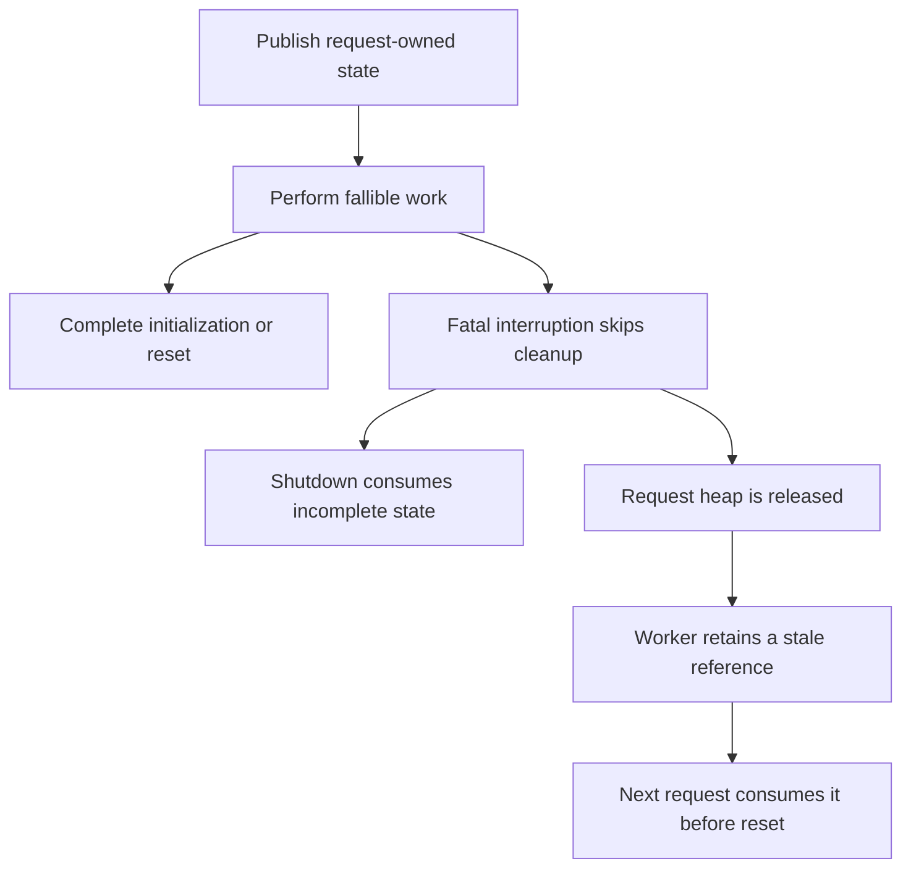

# PHP2Shell analysis and the PHP 8.5.12 patch

Review date: 21 October 2026. Scope: the Wiz post, official advisories, fix
commits, pre- and post-fix code, and relevant regression tests. Method: static
review of public sources; no exploitation chain was executed and no deployed
server was audited.

> English edition of the original Spanish analysis (`docs/es/ANALISIS_PHP2SHELL.md`).
> Technical claims, tables and source links are preserved.

## 1. Result

PHP2Shell groups memory-safety bugs in the interpreter itself. A fatal
interruption can leave structures half-built or references to memory from a
request that has already finished. Cleanup of that request, another request in
the same worker, or — in OPcache — another worker can consume that invalid
state. Consequences include denial of service, memory disclosure and code
execution with the privileges of the web process.

The patch addresses three distinct obligations: complete or abandon memory
operations safely; reinitialise data before any early consumer; and publish
OPcache shared state coherently. Section 4 reconstructs these obligations from
the code; section 5 reviews the design.

The official identifiers are:

| Identifier | Official category | Advisory |
| --- | --- | --- |
| CVE-2026-109618 | Memory corruption via out-of-memory handling | [GHSA-w8hw-w9fx-j79w][A1] |
| CVE-2026-109619 | Use of stale global state between requests | [GHSA-6wmf-4rv5-p3rp][A2] |

Both advisories assign critical severity, CVSS **4.0: 9.2**, vector
`CVSS:4.0/AV:N/AC:H/AT:P/PR:N/UI:N/VC:H/VI:H/VA:H/SC:N/SI:N/SA:N`. The score
combines network access without authentication, high complexity and additional
attack conditions; it does not mean identical exploitation on every
installation. [A1] [A2]

## 2. Versions and dates

| Stable branch | Versions before the fix | First fixed release |
| --- | --- | --- |
| 8.2 | 8.2.0–8.2.34 | 8.2.35 |
| 8.3 | 8.3.0–8.3.35 | 8.3.36 |
| 8.4 | 8.4.0–8.4.26 | 8.4.27 |
| 8.5 | 8.5.0–8.5.11 | 8.5.12 |

The matrix comes from the announcement and the official advisories. It applies
to upstream versions: a vendor can incorporate the fix through a backport
without changing the version number. PHP also announces the fix in 8.6.0 RC4, a
test release. [A3]

Older branches are not declared safe merely by being outside that table. Calif
places an affected route from PHP 5.4.0. PHP exceptionally published minimal
source backports for [7.4][B74], [8.0][B80] and [8.1][B81]; that does not
restore ordinary support or amount to a new maintained release. For old
installations, check the vendor bulletin or migrate to a supported branch.
[A5] [A3]

There is a documentary discrepancy: the requested [changelog][A4] dates 8.5.12
to **22 October**, while the announcement and the [release published on
GitHub][REL] correspond to **21 October 2026**; its API records publication at
14:06:46 UTC. The changelog must not be used to infer that the patch was
unavailable at review time.

The PHP Foundation explains the change: after identifiers circulated before the
embargo, it moved the planned 22 October publication to 14:00 UTC on 21
October. The changelog keeps the other date. [FOUNDATION]

## 3. What the fix "PRs" actually contain

The changelog links security advisories, not PRs. The main commit and its
propagation across branches were identified:

| Role | Verifiable commit |
| --- | --- |
| Base fix, PHP 8.2, "Avoid state corruption via bailout" | [`3584a98bda0f2c0d367255b046798b0d3a221a19`][C82] |
| Integration in PHP 8.3 | [`c1a5f468d09fc4afc5d738872d5b1d4e87ff1e39`][C83] |
| Integration in PHP 8.4 | [`8a94bb3822b9913926b64078b2dfec5e8092ba1b`][C84] |
| Integration in PHP 8.5 | [`c7273b9ba89cc8c0beaf19c03a77332361e7a89e`][C85] |

Queries for PRs associated with the [base commit][P82] and the [8.5
commit][P85] returned empty lists. Searches by title and GHSA also found no
public fix PR. This is therefore a review of public commits; no review,
approval or discussion of a non-existent PR is attributed in the evidence
consulted. This does not exclude private security coordination.

The complete paginated GitHub response for the base commit contains **389
files, 10,759 lines added and 988 removed**, including **249 new PHPT tests and
17 modified**. The 8.5 integration diff comprises 424 files. These are extensive
infrastructure and test changes, not four independent fixes of a few lines. The
diffs were reviewed by critical areas; no exhaustive audit of every file was
performed. [C82] [C85]

## 4. Technical reconstruction of the vulnerability

### 4.1 The request/process boundary

A worker can serve many requests. A request's heap is freed when it ends, but
certain worker globals and OPcache shared memory survive. Every reference from
those persistent scopes to temporary memory requires a well-defined lifecycle.

In PHP 8.5.11, `php_request_startup()` initialises the executor and activates
the SAPI; later it calls `php_hash_environment()` and then
`zend_activate_modules()`. This allows input and callbacks to be processed
before the ordinary module `RINIT`. During shutdown, `zend_deactivate_modules()`
depends on `PG(modules_activated)`, while heap destruction also happens when
that flag was never set. [OLDMAIN]

The dangerous pattern can be expressed as:



The first outcome allows corruption within the same request. The second
requires the process to retain the state and consume it again. This distinction
explains why eliminating worker reuse only affects certain routes.

**The stale-state family does not require OOM:** compile fatals, uncaught
exceptions, `require` failures, timeouts or late diagnostics that repopulate
already-cleared state can also participate. A reachable producer and consumer
are always required. [A2]

### 4.2 Partially initialised structure: HashTable

The previous implementation of `_zend_hash_str_add_or_update_i()` increments a
table's counters before reserving and fully initialising the new entry. The
relevant order is:

```c
idx = ht->nNumUsed++;
ht->nNumOfElements++;
p = ht->arData + idx;
p->key = key = zend_string_init(str, len, GC_FLAGS(ht) & IS_ARRAY_PERSISTENT);
/* Remaining bucket initialization follows. */
```

Allocating the key can exhaust memory. If a non-local exit interrupts the
function there, the counters already announce a valid entry, but not all its
fields have been set. A destruction routine that walks the published entries
can interpret previous bytes as a `zval` or a pointer. The problem is the
violation of the invariant "every counted entry is destructible". [OLDHASH]

These operations need not be reached from explicit PHP code: registering form
variables and upload metadata also builds tables. The fix adds
failure-propagating allocations and restores the original size if a packed-to-
hash table conversion does not complete. This confirms that protecting only
session pointers would not cover the whole family. [NEWHASH]

### 4.3 Sessions and upload progress before RINIT

The upload-progress mechanism uses session state during body parsing. The
manual documents that this work precedes script execution: changing its options
from the application is too late for the request already arriving. [MSESSION]

`session.upload_progress.enabled` is on by default. The callback can start that
work without the script calling `session_start()` and without a configuration
warning: it is an early route of its own. [MSESSIONCONFIG] [OLDSESSION]

In the old code, the file-start callback can run `php_rinit_session(0)` and
publish `PS(id)`; the multipart end calls the corresponding cleanup. An
interruption between the two can omit that cleanup. If the modules were not
activated either, their ordinary shutdown does not run, but the heap is freed.
The Session module is left with references to freed memory. [OLDSESSION]
[OLDMAIN]

There is also a difference between initialising state at the start of every
multipart body and initialising it only when entering certain file events:
shutdown walks need not have passed through those events. The patch moves a
Session reinitialisation to `MULTIPART_EVENT_START`. The next multipart
processing therefore starts from known values before it can consume them.
[NEWSESSION]

Wiz documents a memory-read manifestation: a stale `PS(id)` is interpreted as a
`zend_string` and its contents reach a response session cookie. Disclosure can
exist without RCE. The post also documents a chain based on deserializer state
and demonstrations on WordPress, Drupal and Joomla. These are results published
by the researchers, not reproductions made here. [A6]

### 4.4 Deserializer state: `BG(unserialize)`

`php_var_unserialize_init()` stores reference and destruction structures in
`BG(unserialize).data`; `level` indicates nesting. When an operation is already
active, another call reuses that state. `php_var_unserialize_destroy()` must
close the level and remove the global pointer when appropriate. [OLDUNSER]

If a fatal error prevents the close and the heap is then freed, the next
consumer can mistake the stale pointer for the context of a still-active nested
deserialization. This is not the well-known PHP object injection: the flaw is in
the lifetime of the native bookkeeping, regardless of whether the original data
was legitimate.

The new `php_basic_early_rinit()` zeroes serialization and deserialization
state, as well as the lock and the early state of the URL rewriter. It is called
after `zend_activate()` and before `sapi_activate()`, ahead of input processing.
The call site is as important as the reset: doing it only in the usual `RINIT`
would leave the window open. [NEWBASIC] [NEWMAIN]

### 4.5 Fatal backtrace and other executor state

PHP 8.5 includes `fatal_error_backtraces`, enabled by default. The backtrace is
kept in `EG(last_fatal_error_backtrace)`, while its contents belong to a
request's context. [MERROR]

Error handling consults or destroys the previous backtrace. If that value
survived the release of its memory, a later request's diagnostic can reach it
before the executor reinitialises it. The fixed code adds explicit invalidation
at the end of executor cleanup; it also resets the error log, the handling mode
and the exception pointer. [NEWZEND] [NEWEXEC]

The defence requires invalidating state also when the ideal cleanup path was not
walked. In `main/main.c`, the fix cleans the last error again before destroying
the memory manager and leaves freed superglobals as `UNDEF`. This is a repair of
the lifetime contract, not a cosmetic change to error messages. [NEWMAIN]

### 4.6 OPcache: incomplete shared publication

OPcache introduces a different scope: shared metadata can refer to indexes in
pointer maps whose effective content is local to each worker. The local counter
`CG(map_ptr_last)` and the shared `ZCSG(map_ptr_last)` must agree with the
indexes already published.

The fix code documents that publishing a class cache slot and exiting before
updating the shared limit lets another process reuse that index for another
purpose. The reader can then treat another object's pointer as a class
reference: cross-worker type confusion. [NEWPERSIST]

The solution introduces `zend_accel_pending_ce_cache_begin()`, `commit()` and
`discard()`. Pending slots are stored locally; they are published only after the
shared boundary is updated. Abandoned windows are discarded. The file-cache
load path also discards pending entries and restores the counter if the
operation fails. [NEWPERSIST] [NEWFILECACHE]

Therefore, terminating a worker does not by itself prove that all shared state
is coherent. Disabling OPcache also does not neutralise the session or core
table routes.

### 4.7 Why the usual limits were not enough

The `main/rfc1867.c` patch identifies two input-surface problems: checking only
the declared size does not necessarily control the bytes read; and storing
multipart headers the parser does not need introduces memory amplification. The
fix checks consumed bytes, keeps only the headers actually used and avoids
storing duplicates. [C82] [NEWRFC]

Calif also describes amplification through empty upload metadata and nested
names: the size of internal structures can far exceed the HTTP body. It also
documents the FPM route that interrupts a deserialization after a successful
startup and reuses the state in a later request. Memory pressure and lifecycle
order are technical conditions; the size of an uploaded file does not summarise
the whole exposure. [A5]

## 5. Review of the patch design

### 5.1 Delayed OOM and two limits

The new memory manager distinguishes the ordinary limit from a hard limit:

| Situation | Behaviour observed in the code |
| --- | --- |
| Ordinary limit exceeded | A pending OOM is recorded and a VM interrupt is requested. |
| Operation uses a fallible allocation | It can return `NULL` or `FAILURE` and keep a valid structure for cleanup. |
| Operation requires the allocation to complete | It can use the margin up to the hard limit to restore its invariants. |
| Safe point reached | `zend_handle_delayed_oom()` processes the error and ends request execution. |
| Unrecoverable allocation would exceed the hard limit | The process is terminated with `_exit(137)`. |

The default hard limit is twice the ordinary limit up to 1 GiB; above that it
adds 1 GiB, with overflow protection. `memory_hard_limit_percent` configures it.
This margin matters for sizing pools and containers. [NEWALLOC] [NEWMAIN]

A review precision: the patch does not remove every `zend_bailout()` in the
interpreter. The delayed handler can still use them when aborting without an
executable frame. The improvement is to avoid an arbitrary jump from an
allocation that leaves broken invariants, and to abort from a suitable context.
The margin must not be read as permission to continue normally after an OOM.
[NEWALLOC]

The observable timing of the failure changes: a test expects script output,
then the fatal error, then its shutdown callback. Crossing the ordinary limit
does not imply an instant abort at that same instruction. If a system
allocation really fails, `zend_out_of_memory()` follows a different path and
ends with `exit(1)`. [TAFTER] [NEWALLOC]

### 5.2 Additional barriers and compatibility

| Area | Change and effect |
| --- | --- |
| Early initialisation | Basic and Session reset state before their input consumers. |
| Shutdown | Backtraces, errors, exceptions and superglobals that could be reached outside the normal cycle are invalidated. |
| Upload progress | Early deserialization keeps objects as incomplete classes and avoids autoload, `__wakeup()`, `__unserialize()` and user callbacks in that phase. |
| Session | Initialization success is checked; active state is no longer forced after a failure. |
| `request_parse_body()` | The callback avoids running upload tracking on an already active session in the application phase. |
| Multipart | Work stops when there is a pending OOM, temporary files are cleaned and variable-registration failures propagate. |
| OPcache | Deferred publication of slots and discard of incomplete operations. |
| VM and 8.5 JIT | Interrupt points compatible with frameless calls and compiled code. |

Evidence: [NEWSESSION], [NEWBASIC], [NEWMAIN], [NEWRFC], [NEWPERSIST] and the
[8.5 diff][C85].

These are observable changes: an extension expecting object callbacks during
upload progress no longer receives them; a request can temporarily use more
memory than the old limit; a hard limit terminates the process without the usual
PHP cleanup. Sessions, multipart uploads, native extensions, output handlers and
restart policies should be validated with the fixed version. These are
consequences of the observed design, not regressions demonstrated by this
review.

There is also a deliberate incompatibility: session records whose objects
contain the exact public properties `__PHP_Incomplete_Class_Name`,
`__PHP_Incomplete_Class_Serialized` or `__PHP_Incomplete_Enum_Case` are
rejected. The test expects destruction of the record to prevent confusion with
the internal representation. [TRESERVED]

My assessment of the fix is favourable with respect to the identified causes: it
adds guarantees on allocations, initialisation and shared publication. Applying
only one of those pieces does not reproduce the full set of guarantees of the
release. The size of the diff and the test coverage do not prove the absence of
any other engine vulnerability.

## 6. Real exploitation conditions

The SAPI's decision after a startup failure is decisive. In mod_php, the handler
can reach the request destructor after the bailout; that destructor calls
`php_request_shutdown()`. In FPM, a failed `php_request_startup()` terminates
the child. But after a successful startup, the FPM loop performs the normal
shutdown and can serve another request. [OLDAPACHE] [OLDFPM]

| Environment or condition | Assessment |
| --- | --- |
| Apache + mod_php | Highest demonstrated exposure: routes exist before application code. |
| FPM, failure during startup | The child terminates; it does not survive to consume its state in the next request. |
| FPM, failure after startup | It can survive; RCE has been validated for the session cycle, depending on a suitable application operation. |
| FrankenPHP / LSAPI | The advisories describe susceptibility through code analysis and conditions; this is not equivalent to all mod_php demonstrations. |
| Single-request process | Reduces cross-request routes; it does not prove protection against corruption during cleanup or against shared state. |

The OOM advisory does not declare a complete FPM exploit for **109618**. The FPM
demonstration through deserializer state corresponds to the session cycle
described in section 4.4. [A1] [A5]

The backtrace route requires an early consumer. In FPM, `PHP_VALUE` /
`PHP_ADMIN_VALUE` from the frontend can produce it; pool values are applied when
the worker is created and `.user.ini` after request initialisation. Any warning
does not demonstrate exploitability. [A2]

Assessing an installation requires the real version or backport, SAPI,
extensions, effective configuration, frontend, input routes and worker
survival.

In **Apache prefork + `mod_php`** environments, a persistent HTTP/1.1 connection
(**Keep-Alive**) deterministically ensures that sequential requests run in the
**same worker process (same PID and same virtual address space)**. Likewise,
after a fatal memory error (`Fatal error: Allowed memory size exhausted`),
`zend_bailout()` interrupts the request but Apache **does not terminate the
child process**, allowing the worker to survive and retain stale references
(`PS(id)`, `BG(unserialize)`) in global memory for later requests. Authentication
implemented inside the script also does not protect interpreter code executed
before it. These are deductions and validations from the reviewed execution
cycle.

## 7. Critical reading of the Wiz post and RCE mechanics

The post provides demonstrations and four manifestations: upload-progress
deserializer, disclosure through session, fatal backtrace and OPcache type
confusion. Its table groups bugs by CVE in a way that does not exactly match the
final conceptual organisation of the advisories. For inventory and remediation,
the official names and requirements must be preserved; manifestations can share
mechanisms. [Wiz][A6]; [A1] [A2].

### 7.1 RCE chain mechanics without ROP gadgets (`PG(auto_prepend_file)`)

The technical demonstration published by Wiz (see the [video][WIZ_VIDEO]) shows
how they turned memory corruption into **remote command execution independent
of the distribution or `libc` version**, without ROP chains or binary shellcode
(`GADGETS: none; runtime-resolved PHP global-pointer override`):

1. **OOM trigger and raw memory leak (ASLR bypass):**
   - A `multipart/form-data` request with multiple empty entries
     (`filename=""`) saturates `rfc1867.c` before `RINIT`.
   - The `zend_bailout()` leaves the session pointer `PS(id)` pointing to
     memory freed by the allocator (`ZendMM`).
   - The HTTP response returns a live 256-byte window in the
     `Set-Cookie: PHPSESSID=...` header (*Raw Disclosure*).
   - From that leak, the exploit extracts 64-bit pointers into `libphp.so`'s
     code and data sections (`text` and `rodata`) and the heap's main chunk.
2. **Dynamic symbol resolution in memory:**
   - Instead of depending on fixed OS or `libc` offsets, the exploit resolves
     the ELF header of `libphp.so` present in process memory to locate the
     `php_core_globals` structure.
   - It finds the exact position of the `char *auto_prepend_file` pointer
     (`PG(auto_prepend)`).
3. **Heap grooming via Keep-Alive:**
   - Over the same persistent TCP connection, it sends calculated requests so
     that the Zend Memory Manager allocates attacker data in the freed memory
     slot.
   - It overwrites `PG(auto_prepend_file)` so it points to a stream or in-memory
     payload containing PHP code (e.g. `<?php system('/usr/bin/id');?>`).
4. **Native execution in the interpreter:**
   - On the next request to the same worker, the PHP engine legitimately
     consults its global `PG(auto_prepend_file)` directive, compiles the
     in-memory payload and runs the command with `www-data` privileges in about
     65 seconds.

This technique makes the exploit **universal**: it does not break with minor
changes to system libraries, because it uses PHP's own compiler and interpreter
as the executor.

### 7.2 Evaluation of the communicated scope

The PHP Foundation text also mentions FPM RCE alongside the OOM section. Given
that difference in presentation, this report uses the GHSA requirements and
classification to separate the families; it does not turn an FPM demonstration
into proof of all OOM routes. [FOUNDATION]

The headline claim about 70% reflects PHP's presence on the web, not a
measurement of installations exploitable with a single request. The published
demonstrations prove impact on their targets; they do not replace the
SAPI/configuration matrix. The use of AI does not by itself provide evidence
about a specific configuration either.

Wiz dates its discovery to 19 August, the report to PHP to 24 August and
disclosure to 21 October. Calif reports parallel research, a first report on 11
August and PHP validation of its PoC on 15 August. These are different
timelines, not a reason to assign all the work to Wiz's report date. [Wiz][A6];
[Calif][A5].

This review did not verify active exploitation of PHP2Shell on the Internet. The
Foundation stated that it had not identified public functional exploits at the
time of publication; that observation is limited to that moment. Publication of
technical details, existence of demonstrations and observation of real attacks
must be kept separate. [FOUNDATION]

## 8. Remediation and detection

### 8.1 Primary action

Update the runtime to a fixed version or to a package with an accredited
backport; rebuild the corresponding images and replace the old processes.
Updating only the CMS does not change the interpreter's vulnerable code. Check
the version that actually serves requests, not only the CLI or an image tag.
[A3]

Proposed operational criterion: inventory all pools and services, evidence of
the fixed package, absence of workers with old binaries, and functional
verification of sessions and uploads. If intrusion is suspected, preserve
evidence and review exposed credentials: installing the patch neither revokes
secrets nor removes persistence an attacker may have created.

### 8.2 Temporary measures, with limited scope

For OOM, PHP recommends `memory_limit=-1` imposed administratively and
restarting workers; this removes the predictable PHP limit trigger, but a real
allocator failure remains dangerous. Avoid `RLIMIT_AS` and `RLIMIT_DATA`, which
can cause precisely that failure. Apply external resource and decoded-body
limits, considering requests without a useful length. This configuration changes
availability risk and does not replace updating. [A1]

For session routes, disable `session.upload_progress.enabled = Off` before
parsing and restart workers; `ini_set()` is too late. Dynamic tests show that
disabling this directive prevents `rfc1867.c` from running
`php_rinit_session` and setting `PS(id)` in the `Unknown on line 0` phase,
neutralising the `Set-Cookie` memory leak and the global-pointer overwrite
window used by the RCE chain. In PHP 8.5, disabling `fatal_error_backtraces` cuts
that manifestation. Removing early diagnostics and fixing reachable
fatals/timeouts reduces exposure; hiding errors does not prevent access to the
state. These are partial but highly effective immediate measures while the patch
is applied. [A2] [MSESSION]

A WAF can reduce surface while the fix is installed. Cloudflare announced both
request and response rules and maintains the recommendation to patch. Its
coverage depends on the traffic that passes through the protection; this report
did not validate rules against any installation. [WAF]

### 8.3 Investigating possible attempts

As defensive hypotheses derived from the mechanism, correlate by time, path and
worker PID:

- anomalous multipart bodies followed by memory errors or a concentration of
  5xx responses;
- response session cookie values whose size or content is incompatible with the
  expected format;
- restarts, crashes or unexpected child behaviour under the web server user;
- file changes or outbound connections after those events.

These signals are non-specific: an application failure can also cause them.
Their absence does not rule out a leak or a route before application logging.
Avoid indiscriminately logging complete cookies or memory: the collection itself
could store secrets. No universal signature is proposed, and complete detection
is not certified.

## 9. Tests and limits of the verification

The advisories, release availability, commits and the absence of public PRs
associated with the two consulted commits were checked. Relevant files from
`php-8.5.11` and `php-8.5.12` and the paginated base-fix diff were compared.

Five additional static checks confirmed in the fixed source: the early Basic
call, the Session reset at multipart start, the delayed OOM handler, OPcache
slot publication after the shared counter, and backtrace invalidation before
executor reuse. These checks validate the report's claims, not the behaviour of
a compiled binary.

The reviewed tests include cross-request recovery coverage:
`sapi/cli/tests/oom_request_parsing_next_request.phpt` and
`oom_shutdown_function_next_request.phpt` check a later request after OOM,
including autoload behaviour. They are CLI-server tests, not a reproduction of
RCE in an FPM pool. [TREQUEST] [TSHUTDOWN]

Other specific tests make it possible to evaluate what the patch guarantees:

| Test | Expected behaviour |
| --- | --- |
| [`oom_after_main_script.phpt`][TAFTER] | Output before the delayed error and later shutdown execution. |
| [`oom_hard_limit_exceeded.phpt`][THARD] | Ordinary 10 MiB limit, hard 20 MiB limit, termination without shutdown callback. |
| [`rfc1867_no_user_code.phpt`][TUSERCODE] | Preservation of data and object references during upload progress, without running their callbacks until explicit session start. |
| [`rfc1867_incomplete_class_reserved_props.phpt`][TRESERVED] | Rejection of properties that collide with internal state. |
| [`incomplete_class_raw_payload_markers.phpt`][TMARKERS] | User properties must not improperly alter the serialized representation type. |
| [`frameless_interrupt_001.phpt`][TJIT1], [`002`][TJIT2] and [`003`][TJIT3] | Interruption without repeating frameless calls and preservation of state when leaving a JIT trace. |

The patch also adds `ZEND_MM_MAX_ALLOCS` to exercise failures at specific points
in an allocation sequence. This coverage is relevant for detecting intermediate
states that are not tested simply by sending a large input. It does not
exhaustively demonstrate all remote chains or the security of extensions outside
the PHP tree. [C82]

**Not executed:** compilation of fixed PHP, the PHPT suite, sanitizers or HTTP
exploitation tests. The CLI interpreter available in this environment is PHP
8.5.11; using it to claim the patch passes its tests would be incorrect. Its
presence also does not prove that a vulnerable server is listening on this
machine.

For later dynamic validation, use a compiled checkout of the fixed release in an
isolated laboratory and run, from its root:

```sh
USE_ZEND_ALLOC=1 sapi/cli/php -n -d memory_limit=-1 run-tests.php -n \
  sapi/cli/tests/oom_request_parsing_next_request.phpt \
  sapi/cli/tests/oom_shutdown_function_next_request.phpt
```

In that command, `memory_limit=-1` affects the runner; the tested processes
receive the limits from their PHPT files. Using the harness from the same release
avoids misinterpreting child termination.

With CGI and the required extensions compiled, including `zend_test` via
`--enable-zend-test`, the project mechanism can be extended:

```sh
USE_ZEND_ALLOC=1 make test TESTS="Zend/tests/oom_soft_limit_exceeded.phpt Zend/tests/oom_hard_limit_exceeded.phpt Zend/tests/oom_request_parsing.phpt ext/session/tests/rfc1867_no_user_code.phpt ext/session/tests/rfc1867_incomplete_class_reserved_props.phpt ext/standard/tests/serialize/incomplete_class_raw_payload_markers.phpt ext/opcache/tests/jit/frameless_interrupt_001.phpt ext/opcache/tests/jit/frameless_interrupt_002.phpt ext/opcache/tests/jit/frameless_interrupt_003.phpt"
```

Then validate each deployment SAPI. A `SKIP` result due to a missing extension
does not count as a passed test; several OOM tests exclude specific allocator or
sanitizer configurations. Acceptance criteria: no `FAIL`/`BORK`, justified
exclusions, controlled memory failure, correct state in the next request and
working legitimate sessions and uploads. Complement with compatible
instrumentation to detect memory errors. Demonstrating those dynamic criteria is
outside what was verified here. [RUNNER]

## Sources and reviewed code

Code references are pinned to a commit or to the analysed release tags. Web
advisories may be updated after this review.

[A1]: https://github.com/php/php-src/security/advisories/GHSA-w8hw-w9fx-j79w
[A2]: https://github.com/php/php-src/security/advisories/GHSA-6wmf-4rv5-p3rp
[A3]: https://www.php.net/archive/2026.php#2026-10-21-5
[A4]: https://www.php.net/ChangeLog-8.php#8.5.12
[A5]: https://calif.io/php2shell/
[A6]: https://www.wiz.io/blog/php2shell-php-rce
[WIZ_VIDEO]: https://youtu.be/H7JWNiQpaT8
[FOUNDATION]: https://thephp.foundation/blog/2026/10/21/todays-php-security-release-and-how-were-strengthening-php-security/
[REL]: https://github.com/php/php-src/releases/tag/php-8.5.12
[B74]: https://github.com/php/php-src/tree/PHP-7.4-CVE-2026-109618-109619
[B80]: https://github.com/php/php-src/tree/PHP-8.0-CVE-2026-109618-109619
[B81]: https://github.com/php/php-src/tree/PHP-8.1-CVE-2026-109618-109619
[C82]: https://github.com/php/php-src/commit/3584a98bda0f2c0d367255b046798b0d3a221a19
[C83]: https://github.com/php/php-src/commit/c1a5f468d09fc4afc5d738872d5b1d4e87ff1e39
[C84]: https://github.com/php/php-src/commit/8a94bb3822b9913926b64078b2dfec5e8092ba1b
[C85]: https://github.com/php/php-src/commit/c7273b9ba89cc8c0beaf19c03a77332361e7a89e
[P82]: https://api.github.com/repos/php/php-src/commits/3584a98bda0f2c0d367255b046798b0d3a221a19/pulls
[P85]: https://api.github.com/repos/php/php-src/commits/c7273b9ba89cc8c0beaf19c03a77332361e7a89e/pulls
[OLDMAIN]: https://github.com/php/php-src/blob/php-8.5.11/main/main.c#L1871
[OLDHASH]: https://github.com/php/php-src/blob/php-8.5.11/Zend/zend_hash.c#L904
[NEWHASH]: https://github.com/php/php-src/blob/php-8.5.12/Zend/zend_hash.c#L1332
[OLDSESSION]: https://github.com/php/php-src/blob/php-8.5.11/ext/session/session.c#L3264
[NEWSESSION]: https://github.com/php/php-src/blob/php-8.5.12/ext/session/session.c
[OLDUNSER]: https://github.com/php/php-src/blob/php-8.5.11/ext/standard/var_unserializer.re#L60
[NEWBASIC]: https://github.com/php/php-src/blob/php-8.5.12/ext/standard/basic_functions.c#L491
[NEWMAIN]: https://github.com/php/php-src/blob/php-8.5.12/main/main.c
[NEWZEND]: https://github.com/php/php-src/blob/php-8.5.12/Zend/zend.c#L1508
[NEWEXEC]: https://github.com/php/php-src/blob/php-8.5.12/Zend/zend_execute_API.c#L439
[NEWPERSIST]: https://github.com/php/php-src/blob/php-8.5.12/ext/opcache/zend_persist.c#L337
[NEWFILECACHE]: https://github.com/php/php-src/blob/php-8.5.12/ext/opcache/zend_file_cache.c#L2087
[NEWRFC]: https://github.com/php/php-src/blob/php-8.5.12/main/rfc1867.c
[NEWALLOC]: https://github.com/php/php-src/blob/php-8.5.12/Zend/zend_alloc.c
[OLDAPACHE]: https://github.com/php/php-src/blob/php-8.5.11/sapi/apache2handler/sapi_apache2.c#L557
[OLDFPM]: https://github.com/php/php-src/blob/php-8.5.11/sapi/fpm/fpm/fpm_main.c#L1838
[MSESSION]: https://www.php.net/manual/en/session.upload-progress.php
[MSESSIONCONFIG]: https://www.php.net/manual/en/session.configuration.php
[MERROR]: https://www.php.net/manual/en/errorfunc.configuration.php
[WAF]: https://blog.cloudflare.com/php-vulnerabilities-waf-protection/
[TREQUEST]: https://github.com/php/php-src/blob/php-8.5.12/sapi/cli/tests/oom_request_parsing_next_request.phpt
[TSHUTDOWN]: https://github.com/php/php-src/blob/php-8.5.12/sapi/cli/tests/oom_shutdown_function_next_request.phpt
[TAFTER]: https://github.com/php/php-src/blob/php-8.5.12/Zend/tests/oom_after_main_script.phpt
[THARD]: https://github.com/php/php-src/blob/php-8.5.12/Zend/tests/oom_hard_limit_exceeded.phpt
[TUSERCODE]: https://github.com/php/php-src/blob/php-8.5.12/ext/session/tests/rfc1867_no_user_code.phpt
[TRESERVED]: https://github.com/php/php-src/blob/php-8.5.12/ext/session/tests/rfc1867_incomplete_class_reserved_props.phpt
[TMARKERS]: https://github.com/php/php-src/blob/php-8.5.12/ext/standard/tests/serialize/incomplete_class_raw_payload_markers.phpt
[TJIT1]: https://github.com/php/php-src/blob/php-8.5.12/ext/opcache/tests/jit/frameless_interrupt_001.phpt
[TJIT2]: https://github.com/php/php-src/blob/php-8.5.12/ext/opcache/tests/jit/frameless_interrupt_002.phpt
[TJIT3]: https://github.com/php/php-src/blob/php-8.5.12/ext/opcache/tests/jit/frameless_interrupt_003.phpt
[RUNNER]: https://github.com/php/php-src/blob/php-8.5.12/run-tests.php
